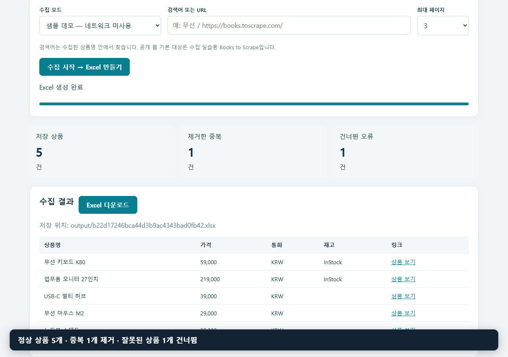
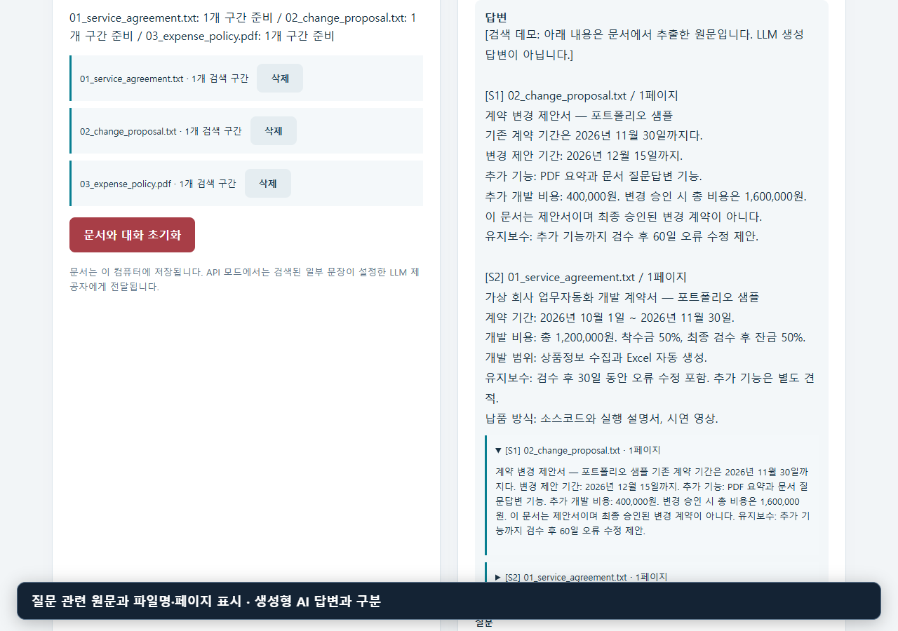
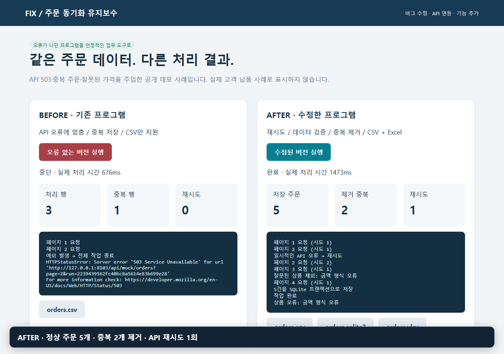

# 업무 자동화 · 문서 검색 · 유지보수 · Discord 개발

반복 업무를 줄이고, 기존 프로그램을 고치고, 커뮤니티 운영을 돕는 실행 가능한 프로젝트 모음입니다.
각 폴더에서 소스 코드, 설치 방법, 샘플 데이터와 검증 범위를 확인할 수 있습니다.

## 실제 실행 영상

아래 영상은 로컬 앱을 Chrome에서 직접 실행한 화면입니다. 결과 API에 가짜 응답을 넣지 않았습니다.
상품·문서는 자체 제작한 샘플이며, 문서 검색 영상은 LLM을 호출하지 않는 검색 모드입니다.

| 프로젝트 | 실행 영상 | 보여 주는 결과 |
| --- | --- | --- |
| [01 상품정보 수집기](01-product-collector) | [영상 재생](01-product-collector/demo/demo.mp4) | 중복 제거 → 상품 5개 → Excel 다운로드 |
| [02 문서 검색 도우미](02-document-assistant) | [영상 재생](02-document-assistant/demo/demo.mp4) | TXT·PDF 업로드 → 질문 → 파일·페이지·원문 출처 |
| [03 프로그램 유지보수](03-maintenance-case) | [영상 재생](03-maintenance-case/demo/demo.mp4) | API 장애로 중단 → 재시도·중복 제거 → 파일 저장 |
| [04 Minecraft AI NPC](04-minecraft-ai-npc) | 실제 게임 영상 준비 중 | NPC·플레이어별 대화 기억, Paper 플러그인 |
| [05 Discord 운영 봇](05-discord-operations-bot) | 실제 Discord 영상 준비 중 | 회원 역할, 비공개 문의, 운영 처리 기록 |

### 상품 수집 → Excel

[](01-product-collector/demo/demo.mp4)

### 문서 업로드 → 출처 확인

[](02-document-assistant/demo/demo.mp4)

### 장애 재현 → 수정 결과 비교

[](03-maintenance-case/demo/demo.mp4)

## 새 프로젝트: Discord 운영 봇

서버 관리자가 `/setup`으로 패널을 설치하면 회원이 역할을 선택하거나 비공개 문의를 열 수 있습니다.
중복 클릭과 재시작에도 열린 문의를 재사용하고, 운영진은 문의를 종료하거나 `/audit`으로 처리 기록을 확인합니다.
SQLite 저장, 영구 버튼, 권한 검사와 자동 테스트를 포함합니다.

[기능·설치 안내](05-discord-operations-bot/README.md) · [실제 Discord 촬영 순서](05-discord-operations-bot/demo/SCENARIO.md)

## 실행과 검증

Python 프로젝트는 Python 3.11 이상이며 각 폴더에서 실행합니다.

```bash
cd 01-product-collector
python -m venv .venv
# Windows: .venv\Scripts\Activate.ps1
# macOS/Linux: source .venv/bin/activate
python -m pip install -r requirements.txt
python -m uvicorn app:app --host 127.0.0.1 --port 8101
```

문서 도우미는 8102, 유지보수 데모는 8103 포트를 사용합니다.
Discord 봇은 `python bot.py`로 실행하며, `.env.example`의 서버 설정과 본인 봇 토큰이 필요합니다.
Minecraft는 `04-minecraft-ai-npc/dist/ai-npc-1.0.0.jar`를 Paper 서버의 `plugins/`에 설치합니다.

2026-10-21 Windows / Python 3.12에서 Python 테스트 **38개 통과**를 확인했습니다.
브라우저 실행에서는 실제 Excel 다운로드 파일도 열어 행 수를 검사했습니다.
[검증 기록과 미검증 항목](VERIFICATION.md)에서 범위를 확인할 수 있습니다.

## 시연 자료 재생성

`tools/record_demos.py`는 웹앱 3개를 실행하고 실제 클릭·문서 업로드·다운로드를 녹화합니다.
각 `demo/evidence.json`에 검증 결과를 기록합니다. 자막은 사용 모드를 설명하며 앱 결과를 대체하지 않습니다.

```bash
# 저장소 루트, 세 웹 프로젝트의 requirements도 설치한 환경에서
python -m pip install -r tools/requirements-demo.txt
python -m playwright install ffmpeg
python tools/record_demos.py
```

Chrome 설치가 필요합니다. 개발용 로컬 앱을 실행하므로 공개 서버에 그대로 노출하지 않습니다.

## 구현 범위

- 02: 기본 모드는 원문 검색입니다. LLM 생성 답변은 별도 API 모드와 본인 키가 필요합니다.
- 03: 자체 제작한 장애 재현 예제이며 고객사 납품 사례가 아닙니다.
- 04: JAR의 Java 대화·메모리 코어 실행은 확인했습니다. 실제 게임 접속과 유료 LLM 연동은 미검증입니다.
- 05: 자동 검증에는 테스트용 Discord gateway를 사용합니다. 실제 Discord 접속 검증과 촬영은 남아 있습니다.

환경 파일·토큰·실행 중 생성되는 DB와 개인 자료는 저장소에서 제외합니다.
